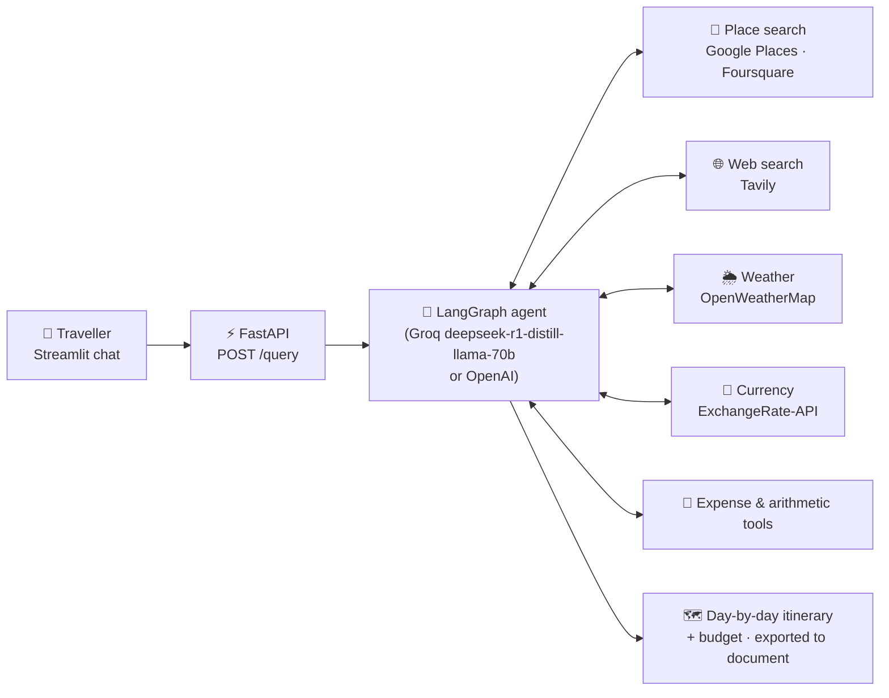

<!-- AI Trip Planner — Agentic Travel Assistant · README -->
<div align="center">


<br/>


<br/><br/>

<a href="#-overview"><b>Overview</b></a> •
<a href="#-architecture"><b>Architecture</b></a> •
<a href="#-engineering-highlights"><b>Highlights</b></a> •
<a href="#-quick-start"><b>Quick Start</b></a> •
<a href="#-recruiter-snapshot"><b>Recruiter Snapshot</b></a> •
<a href="#-contact"><b>Contact</b></a>

</div>

---

# 🧭 Overview

An **agentic travel assistant** that turns a request like *"Plan a 4-day budget-friendly food & sightseeing trip to Tokyo"* into a **complete, costed, day-by-day itinerary**. A **LangGraph** agent decides which tools to call — places, live web search, weather, currency conversion and expense calculation — and composes the results into a readable travel plan.

---

# 🏗️ Architecture

<details open>
<summary><b>🧠 How the agent plans a trip (click to collapse)</b></summary>

<br/>



The compiled graph is rendered automatically to `my_graph.png` on startup.

</details>


---

# ⚙️ Engineering Highlights

<details open>
<summary><b>🏁 Design choices (click to collapse)</b></summary>

<br/>

<table>
<tr>
<td width="25%" valign="top">

### 🔁 Tool-Calling Loop
Agent iterates between reasoning and tool calls until the plan is complete — not a single prompt.

</td>
<td width="25%" valign="top">

### 🧩 Modular Tools
Each integration lives in `tools/` with logic in `utils/`, so APIs can be swapped without touching the graph.

</td>
<td width="25%" valign="top">

### 🔀 Provider-Agnostic
`ModelLoader` switches between Groq and OpenAI via `config.yaml`.

</td>
<td width="25%" valign="top">

### 🏭 Production Layout
Custom logger & exception handling, `setup.py`/`pyproject` packaging, decoupled API + UI.

</td>
</tr>
</table>

</details>


---

# 🚀 Quick Start

```bash
pip install -r requirements.txt
cp .env.name .env          # add GROQ / GPLACES / TAVILAY keys
uvicorn main:app --port 8000 --reload      # terminal 1
streamlit run streamlit_app.py             # terminal 2 → http://localhost:8501
```

---

# 🎯 Recruiter Snapshot

<details open>
<summary><b>📌 What to remember in 15 seconds (click to collapse)</b></summary>

<br/>

<table>
<tr>
<td width="50%" valign="top">

### ✅ Demonstrated
- Agentic workflows with LangGraph
- Multi-API tool integration
- LLM provider abstraction
- Client–server GenAI app

</td>
<td width="50%" valign="top">

### 🧠 Why it matters
- Real data, not hallucinated plans
- Cost-aware outputs
- Clean, extensible codebase

</td>
</tr>
</table>

</details>


---

# 📚 Full Technical Documentation

<details>
<summary><b>🛠️ Setup, configuration, API reference and implementation details (click to expand)</b></summary>

<br/>

A state-of-the-art **Agentic Travel Assistant** that compiles, plans, and budgets highly personalized itineraries. Powered by a **LangGraph-orchestrated workflow**, this application leverages specialized agent nodes to dynamically fetch real-time search, places, weather, and currency data to deliver complete travel blueprints.

---

## 🚀 Key Features

*   **LangGraph Orchestration**: Employs a complex, stateful multi-agent decision graph. On execution, the agent's workflow graph is dynamically compiled and saved locally as `my_graph.png`!
*   **Google Places Integration**: Fetches top-tier local restaurants, sightseeing attractions, and hotels using the **Google Places API**.
*   **Real-time Web Search**: Resolves flight tickets, local events, and travel advisories in real-time via the **Tavily Search Engine**.
*   **Weather & Finance Tooling**: Uses live **OpenWeatherMap** forecasts and real-time **Exchange Rate** endpoints to optimize packing advice and budget allocations.
*   **FastAPI Backend & Streamlit UI**: Standard decoupled client-server architecture with a clean, streamlined Streamlit interactive chat room communicating with a FastAPI REST server.

---

## 📁 System Architecture

```text
AI-Trip-Planner/
├── agent/
│   └── agentic_workflow.py    # LangGraph definition, state management, and nodes
├── config/                    # Core configuration schemas and variables
├── tools/                     # Python tools (Google Places, Tavily, Weather, Exchange)
├── utils/                     # Document saving utilities and helpers
├── main.py                    # FastAPI server exposing the POST /query agent endpoint
├── streamlit_app.py           # Interactive Streamlit frontend chat client
├── requirements.txt           # Agentic dependencies and core integrations
├── pyproject.toml / setup.py  # Local module build system
├── .env                       # API Credentials file (Tavily, Google, Groq, etc.)
└── my_graph.png               # Autogenerated visual diagram of the LangGraph agent
```

---

## 🛠️ API Credentials & Setup

The agent requires specific tool keys to planning trips. Copy `.env.name` to `.env` and fill in the following credentials:

| Environment Variable | Source / Purpose | Required? |
| :--- | :--- | :--- |
| `GROQ_API_KEY` | [Groq Console](https://console.groq.com/) - Lightning-fast inference (Llama 3/Mixtral) | **Yes** (or OpenAI) |
| `OPENAI_API_KEY` | [OpenAI Console](https://platform.openai.com/) - Core GPT LLM capabilities | Optional |
| `GPLACE_API_KEY` | [Google Cloud Console](https://console.cloud.google.com/) - Places and food details | **Yes** |
| `TAVILAY_API_KEY` | [Tavily AI](https://tavily.com/) - Live travel search operations | **Yes** |
| `OPENWEATHERMAP_API_KEY` | [OpenWeatherMap](https://openweathermap.org/api) - Destination weather reports | Optional |
| `EXCHANGE_RATE_API_KEY` | [ExchangeRate-API](https://www.exchangerate-api.com/) - Budget conversions | Optional |
| `FOURSQUARE_API_KEY` | [Foursquare Developers](https://location.foursquare.com/) - Alternative location API | Optional |
| `LANGCHAIN_API_KEY` | [LangSmith](https://smith.langchain.com/) - Tracing and debugging dashboard | Optional |

---

## 📦 Installation & Getting Started

### 1. Set Up Virtual Environment
Initialize and activate your environment in a terminal:
```bash
# Create virtual environment
python -m venv venv

# Activate it (Windows)
venv\Scripts\activate

# Activate it (macOS/Linux)
source venv/bin/activate
```

### 2. Install Dependencies
```bash
pip install -r requirements.txt
```

### 3. Configure Credentials
Create a `.env` file in the root directory and paste your keys:
```text
GROQ_API_KEY=gsk_your_groq_key
GPLACE_API_KEY=your_google_places_key
TAVILAY_API_KEY=your_tavily_search_key
OPENWEATHERMAP_API_KEY=your_weather_key
EXCHANGE_RATE_API_KEY=your_exchange_key
```

---

## 🖥️ Running the Application

This is a decoupled client-server application. You need to launch **both** the backend and the frontend in separate terminals:

### Step 1: Start the FastAPI Backend
```bash
uvicorn main:app --host 0.0.0.0 --port 8000 --reload
```
*   The backend will instantly boot, compile your LangGraph state machine, save the visualization as `my_graph.png`, and listen for queries on port `8000`.*

### Step 2: Start the Streamlit Frontend
In a new terminal window:
```bash
streamlit run streamlit_app.py
```
*   Your browser will automatically open to **`http://localhost:8501`**, displaying the travel planner dashboard!*

---

## 🗺️ How it Works under the Hood

1. **User Query**: You ask for a trip plan (e.g., *"Plan a 4-day budget-friendly sightseeing and culinary tour in Tokyo"*).
2. **LangGraph Processing**: The backend FastAPI receives the query, passes it to the compiled graph state-machine.
3. **Agent Collaborations**: 
    - The **Tavily Tool** scans search indexes for flight/travel guidelines.
    - The **Google Places Tool** pulls coordinates, restaurant names, hotel links, and operational hours.
    - The **Weather & Currency Tools** adjust schedules based on weather and perform precise exchange conversions.
4. **Itinerary Compilation**: The final travel agent compiles the retrieved context into a highly readable travel roadmap and returns it to your Streamlit screen.
5. **Autogenerated Logic Graph**: Check `my_graph.png` in the project root to inspect the exact compiled logic model of your Travel Graph!

</details>


---

# 📬 Contact

<div align="center">

**Krishan Kumar** — AI Engineer & Data Scientist · Rome, Italy

<a href="https://www.linkedin.com/in/krishan-kumar-ml/"></a>
<a href="mailto:krishbijarniya@gmail.com"></a>
<a href="https://krishan-kumar-portfolio.vercel.app/"></a>
<a href="https://github.com/krishanbijarniya"></a>

</div>


